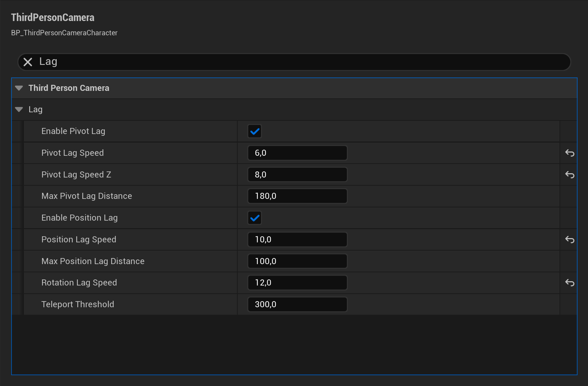

# Third Person Action Camera

**FunByDefault · Version 1.0**

## Quickstart: use it on your character

Start with the plugin installed for your Unreal Engine version and a playable **Character or Pawn Blueprint** with movement and look input. No C++ is required for this setup.

1. Open **Edit → Plugins**, find **Third Person Action Camera**, enable it and restart the editor if requested.
2. Open your player Blueprint. In **Components**, deactivate its existing Camera by clearing **Auto Activate**, or remove the old **Spring Arm + Camera** pair. Keep any other cameras inactive until your game explicitly switches to them.
3. Select the Capsule Component or another stable root component. Choose **Add → Third Person Camera**. The new component replaces both the boom and camera. Leave **Auto Activate** enabled and its inherited **Use Pawn Control Rotation** disabled.
4. In **Class Defaults**, search for **Find Camera Component When View Target** and leave it enabled. The component must belong to the Pawn controlled by the local PlayerController, and that Pawn must be the player's view target.
5. Keep your look Blueprint connected to **Add Controller Yaw Input** and **Add Controller Pitch Input**. The component reads this Control Rotation; it does not create your game's input mappings.
6. Select the new component and tune **Third Person Camera → Boom → Target Arm Length**, **Socket Offset**, and **Pivot → Pivot Offset**. For walls, use **Collision → Collision Presets → Custom** on the wall component and set its **Camera** trace response to **Block**. Query collision must be enabled.
7. **Compile**, **Save**, then **Play** as that character. Move and look around: the view should follow your character, orbit with look input, and retract when a blocking wall obstructs the camera.

> [!TIP]
> The quickest integration is to keep your existing playable character, GameMode and input. For a manually placed test character, **Auto Possess Player → Player 0** is an alternative to spawning it through your GameMode. Avoid spawning a second player character as well.

The camera runs for the selected active camera component on a locally controlled Pawn. Another active camera, an unpossessed Pawn, or a different view target can prevent it from driving the view.

**Contents:** [Framing](#set-the-framing) · [Smoothing](#tune-the-smoothing) · [Input](#connect-your-input) · [Walls](#collision-and-wall-recovery) · [Focus](#frame-a-focus-target) · [Handoffs](#teleports-and-camera-handoffs) · [Diagnostics](#troubleshooting-and-diagnostics) · [Limits](#scope-and-limits) · [Migration](#migration-and-api-policy) · [Support](#support)

## Set the framing

Select the **Third Person Camera** component in your own player Blueprint. Its settings are grouped under **Third Person Camera** in **Details**.

| Setting | Use it for |
|---|---|
| **Pivot → Pivot Offset** | Move the point the camera follows. X/Y follow the owner's yaw; Z is world up. |
| **Pivot → Pivot Socket Name** | Follow a socket on the owner's first skeletal mesh. A missing socket falls back to the owner location. |
| **Boom → Target Arm Length** | Set the normal distance from the pivot. Default: 350 cm. |
| **Boom → Socket Offset** | Adjust shoulder framing in orbit space. Positive Y is right; negative Y is left. |
| **Auto Follow → Enable Auto Follow** | Ease behind movement after manual look becomes idle. Change **Auto Follow Delay** to control the wait. |
| **Pitch → Enable Pitch Modifier** | Vary distance and follow height as the player looks up or down. |
| **Speed → Enable Speed Effects** | Add a bounded distance and field-of-view increase as movement speed rises. |

Distances use Unreal units, normally centimetres. Keep **Control → Write Automated Rotation to Controller** off unless your gameplay deliberately needs automated camera turns to alter Control Rotation. It is off by default.

For a character that faces its movement direction, a common starting point is **Use Controller Rotation Yaw** off in Class Defaults and **Orient Rotation to Movement** on in Character Movement. Your locomotion or aiming system may need different choices.

## Tune the smoothing

**Lag** separates follow-point motion, camera position and orbit rotation. The follow point is the location the camera orbits; it is not a separate lock-on target filter.

| Setting | Default | Effect |
|---|---:|---|
| **Enable Pivot Lag** | On | Smooth movement of the follow point. |
| **Pivot Lag Speed** | 12 | Horizontal follow response. |
| **Pivot Lag Speed Z** | 18 | Vertical follow response, including jumps and steps. |
| **Max Pivot Lag Distance** | 180 cm | Limit how far the follow point may trail. |
| **Enable Position Lag** | On | Smooth the camera's physical position. |
| **Position Lag Speed** | 30 | Camera-position catch-up response. |
| **Max Position Lag Distance** | 100 cm | Limit camera-position trailing distance. |
| **Rotation Lag Speed** | 32 | Smooth the yaw and pitch used to place the camera. |

For these response speeds, **larger positive values feel tighter; smaller positive values feel softer; zero updates immediately**. They use inverse seconds. Collision can reduce the available lag distance to keep the character visible.

Try **6 / 8 / 10 / 12** for Pivot Lag Speed, Pivot Lag Speed Z, Position Lag Speed and Rotation Lag Speed. Walk, stop, jump, then turn the view to judge each response. This is example tuning, not a saved preset.

*Example tuning in Unreal's native Details controls. These suggested values are not a shipped preset.*

> [!NOTE]
> To keep a change, edit the component on your Blueprint outside Play mode, then Compile and Save. Changes to a live play-session instance are temporary.

## Connect your input

The component is independent of your input system. Your Blueprint can use Enhanced Input, legacy input, or UI events.

| Input | Blueprint connection |
|---|---|
| Mouse movement | Feed horizontal and vertical look deltas to **Add Controller Yaw Input** and **Add Controller Pitch Input** on the possessed Pawn. Set sensitivity and inversion in your input logic. |
| Gamepad right stick | Apply a dead zone, multiply each axis by your degrees-per-second rate and frame Delta Seconds, then use the same look nodes. |
| Touch look drag | Convert drag displacement to yaw/pitch deltas and use the same look nodes. Keep touch movement and action buttons in your own UI/input logic. |
| Move | Keep **Add Movement Input** and your Character Movement setup. Use the camera component's world yaw for movement relative to the rendered view, or Control Rotation yaw if your gameplay should follow aim. |
| Focus action | Call **Set Focus Target** with the actor selected by your game. Call **Clear Focus Target** to release it. |
| Shoulder action | Read **Socket Offset**, negate Y, then **Set Socket Offset**. Preserve X and Z. |

For camera-relative movement in a Blueprint: get the component's **Get World Rotation**, keep only Yaw with **Make Rotator**, then use **Get Forward Vector** and **Get Right Vector** as the World Directions for **Add Movement Input**. Keep movement input normalized when combining axes.

The included example controller has mouse/keyboard, gamepad and multi-touch input. Its mappings belong to that controller and are not installed into your own character:

| Action | Keyboard / mouse | Gamepad | Touch |
|---|---|---|---|
| Move | WASD or arrows | Left stick | Lower-left drag area |
| Look | Mouse | Right stick | Look drag area |
| Jump | Space | Bottom face button | Jump button |
| Focus / release | F | Left shoulder | Focus button |
| Swap shoulder | Q | Right shoulder | Shoulder button |
| Suspend camera | C | Top face button | Suspend button |
| Snap camera | R | Left face button | Snap button |
| Debug drawing | Tab | Menu / Start | Debug button |

The example controller selects a visible example focus target within 12 metres. Those selection rules are example behavior, not restrictions imposed by **Set Focus Target**.

## Collision and wall recovery

Leave **Collision → Do Collision Test** enabled and make relevant geometry block **Probe Channel**, which defaults to **Camera**. Use **Probe Radius** for the physical camera clearance and **Enable Predictive Collision** to anticipate upcoming obstruction.

**Wall Recovery → Enable Wall Recovery** lets the camera turn around nearby obstruction through connected, checked positions. When no usable side route exists, collision pulls the camera closer. After clearing a wall, the recovered angle becomes the new orbit basis; the camera does not deliberately swing back to a stored pre-wall angle.

- **Wall Recovery Max Yaw** limits recovery around a stationary character. Moving around the contact advances the allowance.
- **Wall Recovery Engage Speed** controls the response; checked angular steps still limit the applied movement.
- **Wall Recovery Look Ahead Time** anticipates character movement.
- **Collision Blend Out Speed** and **Collision Recovery Delay** control the return to full distance.

> [!IMPORTANT]
> Current obstruction takes priority over smoothing. **Collision Blend In Speed** smooths predicted pull-in; it cannot delay an immediate collision correction. Very tight geometry or fast motion can still cause abrupt distance changes. Review your own routes, speeds and camera settings in motion.

Manual look takes priority while the requested view is clear. Collision may still correct an obstructed view. Focus suspends sideways wall recovery through acquisition and release; physical collision and overhead clearance remain active.

## Frame a focus target

Drag the camera component into your Blueprint graph as a reference. From it, add **Set Focus Target** and connect your target Actor to **New Target**. Use **Socket Name** for an optional skeletal-mesh socket; a missing socket falls back to the actor location.

Connect your release action to **Clear Focus Target**. **Get Focus Target** returns the current live target, or None after clear or destruction. Clearing blends back from the current rendered orientation and leaves controller aim unchanged.

| Focus setting | Purpose |
|---|---|
| **Focus Blend Speed** | Control acquisition/release response for aim, distance and FOV. Default: 6; zero is immediate. |
| **Focus Framing Bias** | Bias the look point from target (0) toward player (1). Default: 0.35. |
| **Enable Focus Auto Framing** | Extend the boom and, when needed, widen FOV to try to fit both subjects. |
| **Focus Subject Radius / Focus Screen Margin** | Reserve space around subjects and screen edges. |
| **Focus Max Arm Length / Focus Max Field Of View** | Cap automatic distance and FOV. Defaults: 1200 cm and 100 degrees. |

Your game supplies target search, range checks, visibility checks, cycling and combat rules. Focus does not implement aim assist or replication. Collision and the distance/FOV caps can prevent both subjects from fitting; character framing takes priority. There is no separate target-position smoothing setting.

## Teleports and camera handoffs

- After a teleport or respawn, call **Snap to Desired** on the component. It resets camera interpolation on the next update without moving the character or clearing a valid focus target.
- Use **Set View Target with Blend** on the PlayerController for another camera actor. The component yields when its Pawn no longer contributes to the player's view.
- If another system directly drives this component, set **Control → Suspend Driving** true first. Clear it when returning control; the camera reinitializes its pose.
- When switching between camera components on the same Pawn, deactivate the old component and activate the new one. Only the first active camera component is selected.

## Troubleshooting and diagnostics

Enable **Third Person Camera → Debug → Draw Debug** during development to see the pivot, camera boom, collision probes and recovery paths. It is off by default and is not intended as shipping UI.

| Symptom | Check |
|---|---|
| View does not change | Local possession, active component, **Find Camera Component When View Target**, correct view target, and **Suspend Driving** off. |
| Another camera wins | Disable **Auto Activate** on unused cameras, and check runtime Activate calls. |
| Mouse or stick does nothing | Your input must update the possessed Pawn's controller rotation. Check mappings, input mode, sensitivity and dead zones. |
| Walls are ignored | Query collision, simple collision geometry, the wall's **Camera** response, and the component's **Probe Channel**. |
| Camera retracts too far | Check for overlapping collision, an initial camera position inside geometry, an oversized probe, or pivot/shoulder offsets placing the view behind a surface. |
| Character motion feels delayed | Increase lag response speeds or lower lag-distance limits. Zero response speed removes smoothing. |
| Focus target leaves the frame | Check target range, subject radius, screen margin, collision and distance/FOV caps. Choose or release targets in your game logic. |
| Sudden move after teleport | Call **Snap to Desired** after the teleport. |

## Scope and limits

This is a local third-person camera component. Use the package for the engine/platform combination advertised for your release. Input integration alone does not establish mobile platform support.

The component does not run on a dedicated server or remote Pawn proxy. It does not provide networked target selection, a tested split-screen support guarantee, first-person modes, camera rails, preset management, or automatic material fading. Your game owns movement, animation, targeting and input mappings.

Collision and focus framing have physical limits. Test continuous movement, fast turns, low ceilings, stairs, focus handoffs and unusual aspect ratios in your own levels. No set of example routes guarantees the result for every layout.

## Migration and API policy

When replacing a Spring Arm setup, transfer distance to **Target Arm Length**, shoulder offset to **Socket Offset**, and follow height to **Pivot Offset**. Retune lag values; different camera implementations do not have identical response curves. Keep your input and gameplay ownership explicit, then retest collision and camera handoffs.

**Wall Recovery Release Speed** is retained for saved-asset compatibility but has no effect. Recovery now keeps its adjusted angle. Leave **Write Automated Rotation to Controller** off unless an older integration requires automated rotation to change gameplay aim.

Public Blueprint nodes, reflected properties and documented C++ entry points are treated as stable API. A replacement will be identified through deprecation and migration instructions before removal. Saved-setting changes require redirects or a verified conversion path. Back up your project before updating and retest saved settings, focus and view-target changes.

Optional C++ reference

The runtime module is `ThirdPersonCamera`; the component header is `ThirdPersonCameraComponent.h`. The same runtime actions are available as `SetFocusTarget(AActor*, FName)`, `ClearFocusTarget()`, `GetFocusTarget()` and `SnapToDesired()`. C++ is optional; the setup and integrations above use editor controls and Blueprint nodes.

## Support

Use the [FunByDefault support Discord](https://discord.com/invite/GKjSWjvEnm). Include product version **1.0**, your exact Unreal Engine version and platform, relevant component values, input device, reproduction steps and a short video when motion is involved. A small reproducible project or collision/layout example helps diagnose the issue. Remove private project content before sharing.
